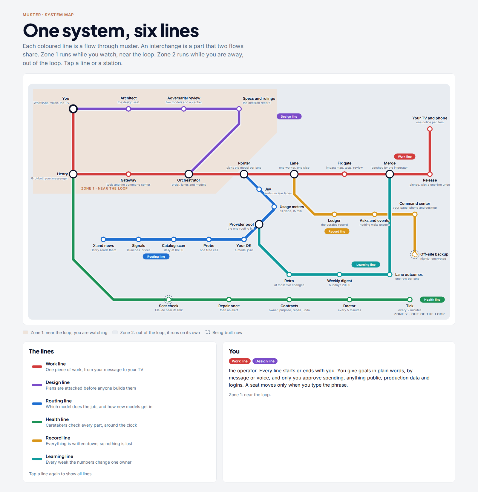
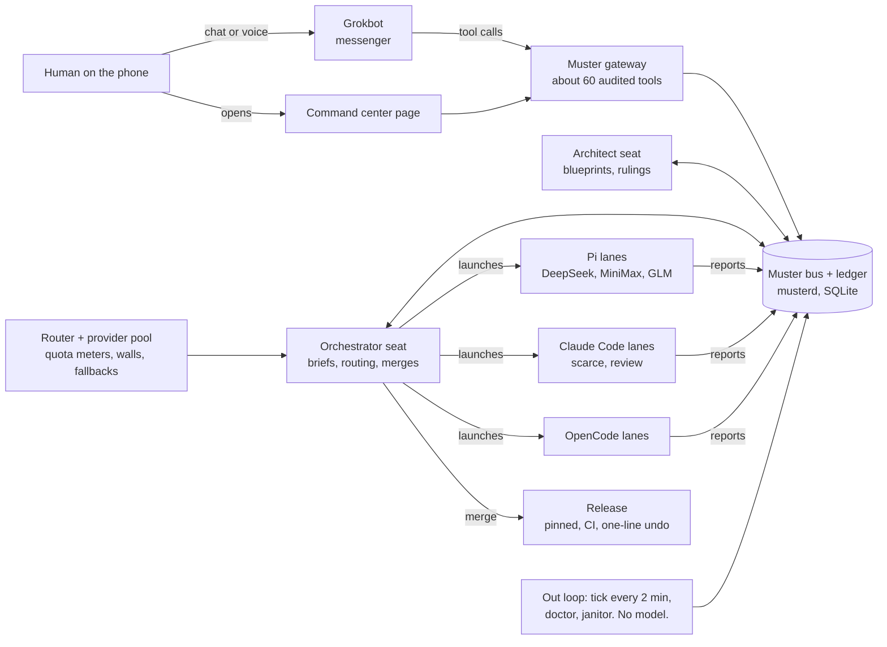
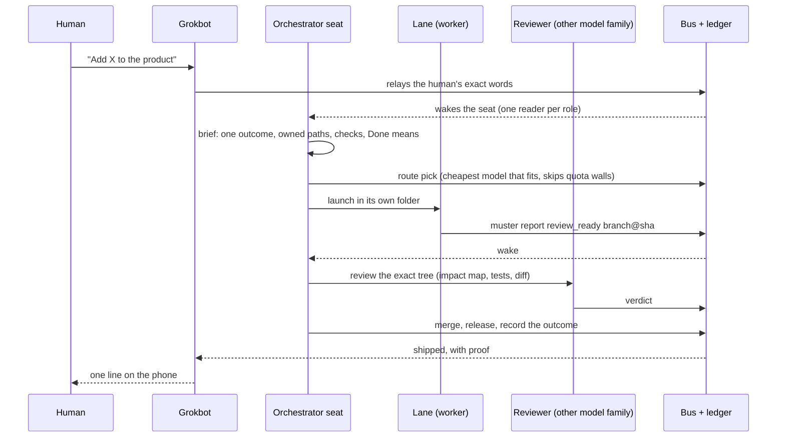

# Muster

**An AI engineering team you run from your phone.** Muster is a coordination bus that turns many AI coding agents, running in different harnesses on different models, into one accountable team. You set the outcome. The agents design, build, review and ship it, with every step recorded. You are asked only when your approval actually matters.

Muster has been in daily use on real product work since September 2026. One person runs it, with **Grokbot as the control layer** on the phone.

**[Presentation (PDF, 13 slides)](docs/presentation/muster-deck.pdf)** · [Diagrams](docs/diagrams/) · [Architecture](#the-parts) · [Grokbot control layer](#grokbot-the-control-layer)

| | |
|---|---|
| Worker runs logged in October 2026 | about 800 (`plans/lane-outcomes.tsv` in the operator profile) |
| Model routing decisions logged | 1,508, each with its candidates and reason |
| Model families doing the work | DeepSeek, Claude, GLM, MiniMax, Grok |
| Agent harnesses on one bus | Claude Code, Pi, OpenCode |
| This repository | 642 files, about 94,500 lines of TypeScript, about 60,000 lines of tests in 208 test files |



## Why

A single AI agent is a conversation. Real software needs a team and a process: a design, a plan cut into slices, builders, independent review, integration, release, and someone watching it all at night. Single agents forget, stall silently, grade their own work and depend on one vendor's quota. Muster fixes the process, not the model:

- **Roles, not one big prompt.** An architect seat designs, an orchestrator seat plans, routes and merges, and lanes build. Each lane is one worker with one written brief in its own folder.
- **Any model, any harness.** A lane can run in Claude Code, Pi (any provider in the pool) or OpenCode. A seat can move between harnesses without changing the bus.
- **No self-review.** Every change is reviewed by a model from a different family from its author. Fixes pass a gate: an impact map, a test that fails first, then an independent review.
- **Proof before status.** "Merged" names the commit, "live" names the release, "running" names the process. Nothing is typed by hand.
- **The human decides outcomes.** Spending, messages to real people, production data and anything that needs a login stay with the human. Everything else runs without asking.

## Who it is for

- **Solo founders and small studios** who run several products and want a team of agents that keeps working while they are away.
- **Engineering leads** who want AI agents behind the same process as people: written briefs, review by another model, proof before merge.
- **AI platform teams** who mix harnesses and vendors, route by cost and quota, and need fail-over when a provider hits its limit.

## How it works



**One piece of work, end to end:**



More diagrams, interactive, in [`docs/diagrams/`](docs/diagrams/): the [system map](docs/diagrams/system-map.html), [end to end](docs/diagrams/end-to-end.html), [one piece of work](docs/diagrams/one-piece-of-work.html), [model routing](docs/diagrams/model-routing.html) and [the whole system](docs/diagrams/whole-system.html). Each has a PNG beside it.

## The parts

| Part | What it does | Where |
|---|---|---|
| Bus | `send`, `ask`, `report`, `wait`. One inbox per role and per lane, full-text messages, idempotency keys | `muster/send.ts`, `muster/inbox*.ts`, `muster/wait.ts`, `muster/cli/` |
| Ledger | One durable store for messages, events, lanes, asks and decisions. A daemon (`musterd`) on a local socket, SQLite storage, a spool for events written while the daemon restarts | `muster/ledger/` (`daemon.ts`, `stores.ts`, `spool.ts`, `schema.ts`) |
| Seats | The architect and orchestrator roles: who holds each seat, on which harness, at which epoch. A seat moves only on the human's word | `muster/seats.ts`, `muster/seat-adapter.ts` |
| Lanes | Launch, lane cards, stages, health, close, outcomes. One worker, one brief, one folder | `muster/lane-lifecycle.ts`, `muster/lane-stage.ts`, `muster/lib/lane-card.ts`, `muster/scripts/pi-lane-launch.sh` |
| Harness adapters | Claude Code through its hooks, Pi through its extension, OpenCode through its own host per lane | `muster/cli/claude-hook.ts`, `muster/lane-lifecycle-ports.ts` |
| Routing | The provider pool (role chains per lane class), quota meters for each provider, wall detection, fallbacks, a logged decision per placement | `routing/provider-pool.ts`, `routing/provider-policy.ts`, `routing/*-quota.ts`, `muster/cli/route.ts` |
| Asks | The human's queue: every question arrives prepared, with options and a recommendation, and is closed with evidence | `muster/asks.ts`, `muster/cli/ask.ts` |
| Work items | The backlog as records, with states derived from git, reviews and releases | `muster/work-items.ts`, `muster/work-item-state.ts` |
| Gateway | An HTTPS tool server for Grokbot and the command center page: about 60 tools with validated arguments, bearer roles, refusals and an audit log. No shell tool | `muster/gateway/server.ts`, `muster/gateway/tools.ts` |
| Command center | One live page: goals, lanes with their model, what needs the human, what shipped today. Phone, desktop and TV | `muster/gateway/command-center*.ts`, `command-center-page.html` |
| Out loop | Runs with no model while the human is away: a tick every 2 minutes (stalls, stale reviews, quota fallbacks), a doctor that turns each broken contract red, a janitor | `muster/tick.ts`, `muster/health/`, `muster/systemd/` |
| Core | Settings lock, event wake, graph refresh, a secret redactor, harness paths | `core/` |
| Toolbelt | One control surface for the providers' CLIs | `toolbelt/` |

Package direction is enforced by a test: `core` imports nothing, `routing` and `toolbelt` import `core`, `muster` imports all three, and nothing imports the operator's profile at runtime (`core/tests/harness-boundary.test.ts`).

## Grokbot: the control layer

The human talks to Grokbot. Grokbot runs the team. Everything the human needs, from goals to approvals, goes through one conversation on the phone, by chat or voice.

| What Grokbot does | How | Where in the code |
|---|---|---|
| **Front door.** Takes goals and answers from the human and relays the exact words to the architect and orchestrator seats, then wakes them | Bus messages with the human's words verbatim, one reader per role | `muster/grokbot-tell.ts`, `muster/grokbot-wake.ts` |
| **Live board.** Reads lanes, goals, asks, releases and quota windows at any moment | The Muster gateway: about 60 typed tools, bearer roles, refusals and an audit log. No shell tool | `muster/gateway/server.ts`, `muster/gateway/tools.ts` |
| **Decisions as one card.** Every question reaches the human prepared, with options and a recommendation, and closes with evidence | The asks queue | `muster/asks.ts`, `muster/cli/ask.ts` |
| **Live intelligence from X.** Reads X for model launches, price and terms changes, and files them as signals. A free model that passes a probe is offered to the human with one tap before it joins the pool | The signal log and the research desk | `muster/signals.ts`, `muster/research-desk.ts` |
| **Independent reviewer.** Grok reviews risky fixes because it is a different model family from the authors | The fix gate: impact map, failing-first test, review on another family | `routing/provider-pool.ts` (reviewer role) |
| **Guard rails stay human.** Spending, messages to real people and production data go out only on the human's own tap | The send gate and the asks queue | `muster/messaging/send-gate.ts` |

The result: one person directs a multi-model engineering team from a phone, without opening a terminal.

## Running Muster on Grokbot's own system

Today the bus, the ledger and the workers run on one workstation, and Grokbot reaches them through the gateway over a private network. The same pieces can be hosted beside Grokbot, which makes Grokbot the team's home rather than only its messenger:

```mermaid
flowchart TB
  subgraph Grokbot host
    GB[Grokbot chat and voice]
    GW[Muster gateway<br/>tool server]
    MD[(musterd + ledger)]
    TK[Out loop timers]
    subgraph Sandboxes, one per lane
      W1[Lane worker]
      W2[Lane worker]
      W3[Reviewer]
    end
  end
  GB -- tools --> GW --> MD
  TK --> MD
  MD <--> W1 & W2 & W3
  W1 & W2 & W3 --> P[Model providers: Grok, DeepSeek, GLM, MiniMax, Claude]
```

What that takes, in order:
1. Package `musterd`, the gateway and the out-loop timers as one service. They are plain Node processes with systemd units today (`muster/systemd/`, `muster/ledger/musterd.service.template`).
2. Put a sandbox launcher behind the existing lane launch interface, so each lane gets its own container instead of its own folder and cgroup.
3. Point Grokbot's tool calls at the local gateway. The tools, roles and audit log stay as they are.
4. Add Grok models to the provider pool as builders as well as reviewers. Routing already ranks models per lane class and fails over on quota walls.
5. Keep the approval rules: spending, outside messages and production data still need the human's tap.

This is a deployment plan, not yet done. Steps 1, 3 and 5 reuse existing code unchanged.

## Reliability, and what this week taught us

The rules are enforced in code where possible, and written down where not:
- **Fix gate:** impact map, a regression test that fails before the fix and passes after, and a review on another model family. No status without the evidence attached.
- **Adversarial review of every plan:** sections reviewed in parallel by two models from different families, every finding verified against the code, rounds until a round adds nothing.
- **Releases:** pinned, built by one script, with a load check of the Pi extension before the link moves and a one-line undo. The same check for every harness, at merge time, is roadmap item 1.
- **A doctor:** each service has a contract, and a broken contract turns red and reaches the human.

In late October the orchestrator seat ran for two days on a second harness. There it went quiet, a guard meant for that harness paused it, and a fix made for that harness broke the first one. The response is structural, and it is the current roadmap:
- one wake contract for every harness, each harness a thin adapter
- one conformance suite that runs on both harnesses before any merge
- every guard decides from the seat record, never from another harness's signals.

The rule that came out of it: **a change for one harness never breaks a working process on another.**

## Roadmap

1. **Protect the working path.** A merge gate that refuses a tree a harness cannot load, or a review from the author's own model family. Read-only release trees. A flip that works while lanes run.
2. **One wake path for both harnesses.** A shared contract, a small adapter for each harness, and 16 conformance tests on both. Then a live trial with the orchestrator seat on the second harness.
3. **True status everywhere.** One vocabulary per kind (work items, lanes, asks, seats, releases), shown as a plain label next to the backend name, always derived from evidence.
4. **Provider failures as events.** One reading of a failed turn for every consumer: an expired key or a capacity error raises an event and fails over at once.
5. **Hosting on Grokbot,** as above.

## Using it

```bash
scripts/setup.sh                     # installs the four packages a fresh clone needs
./test.sh [files...]                 # the tests, through the guarded runner when one exists
npm run secret-scan                  # the history and tree secret scan

muster lanes                         # every lane: stage, health, model, last activity
muster send orchestrator --stdin     # a message to a role's inbox
muster report review_ready --summary "<what>" --branch <b> --sha <sha>   # how a lane hands in its work
muster ask --help                    # the human's queue of prepared questions
muster route pick --lane <lane> --task-kind <kind>   # which model the router places, and why
muster route explain <lane>          # the logged candidates and reason for a placement
muster usage                         # quota windows per provider
muster seat show orchestrator        # who holds the seat, on which harness
```

Development notes, test layout, CI exclusions and the package rules are in [`docs/DEVELOPMENT.md`](docs/DEVELOPMENT.md).

## Status

This is a working system run by its author. The Pi harness's extension half lives in the operator's Pi profile, not in this repository, and some tests need that profile (they are listed in `scripts/ci-test-exclusions.txt` and skipped in CI). The second-harness wake path and the hosted deployment above are in progress.
